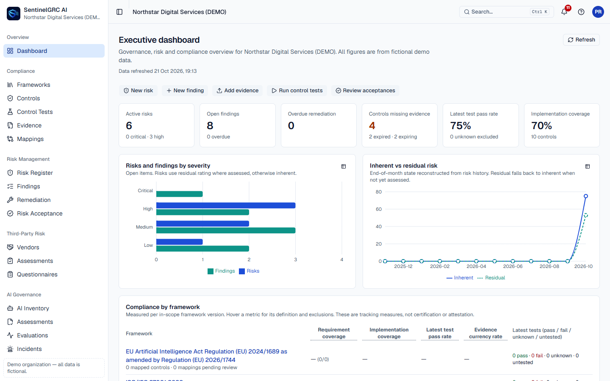
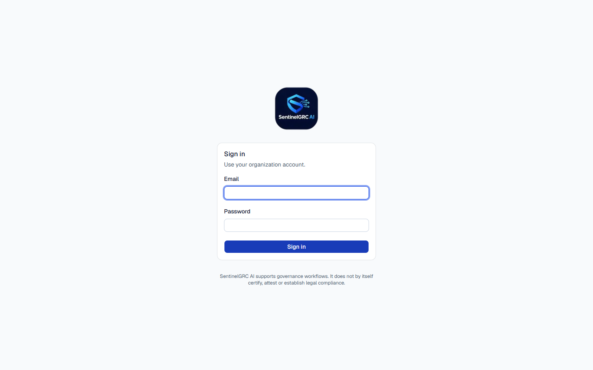
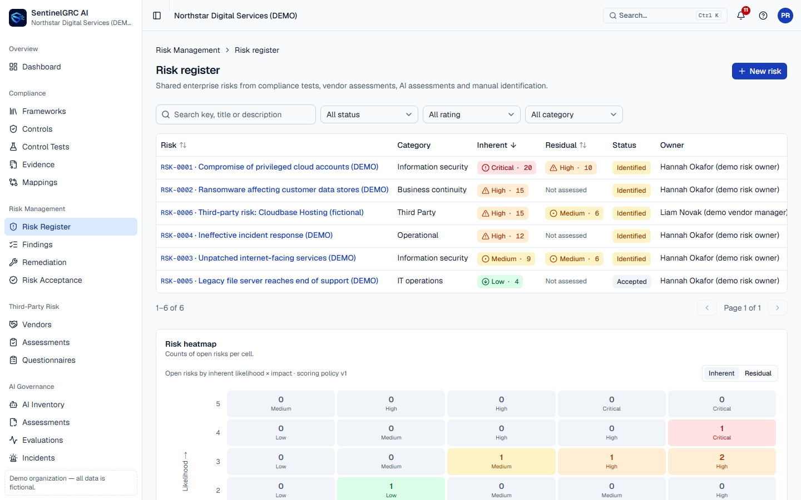
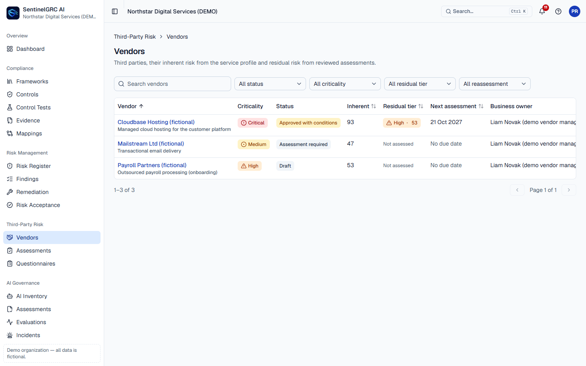
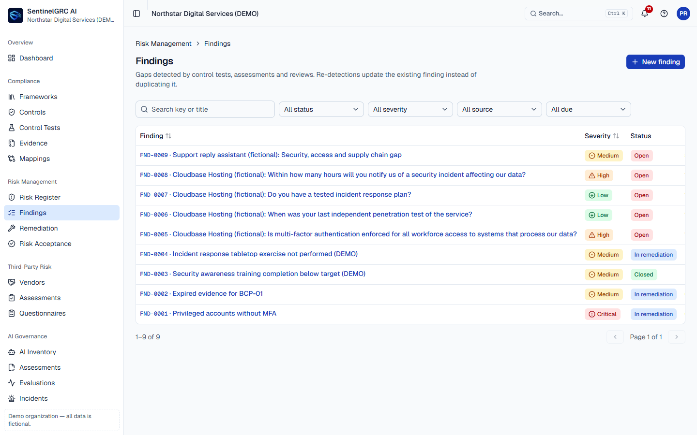
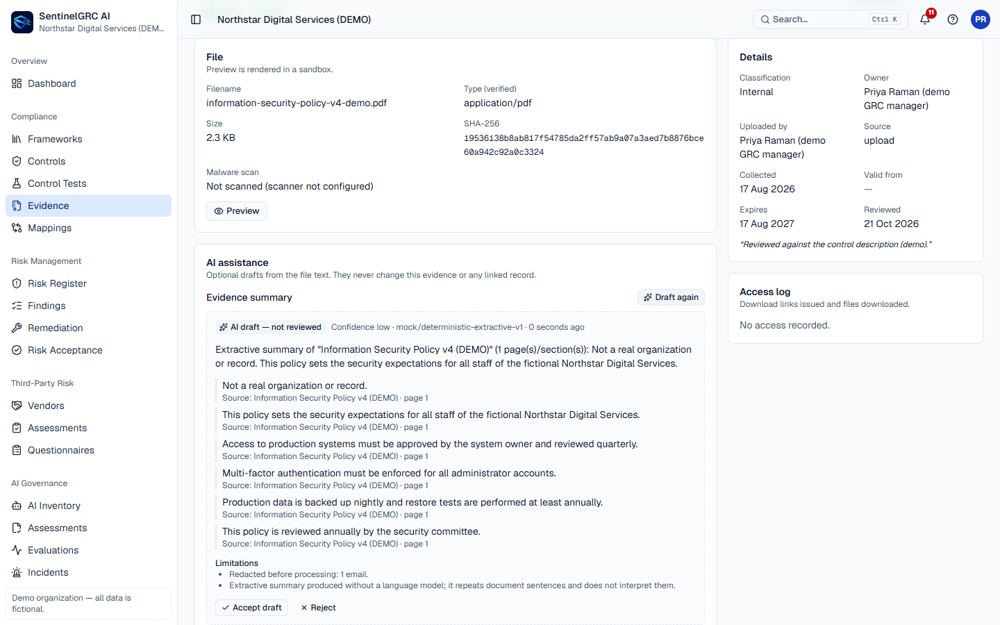

<p align="center">
  
</p>

<h1 align="center">SentinelGRC AI</h1>

<p align="center">
  Multi-tenant governance, risk and compliance platform: compliance tracking, a shared risk register, third-party risk, AI governance, automated control testing and traceable reporting, with an optional, human-reviewed AI assistant.
</p>

> **Disclaimer.** SentinelGRC supports governance workflows. It does **not** certify, attest, issue audit opinions or give legal advice. Framework content, mappings and legal applicability must be verified by qualified people. All demo data shown is fictional.



| Sign in | Risk register and heatmap | Vendors |
|---|---|---|
|  |  |  |

| Findings | AI-assisted evidence review (draft, with sources and limitations) |
|---|---|
|  |  |

## Features

- **Compliance:**
  - Versioned frameworks with provenance: NIST CSF 2.0, NIST AI RMF 1.0, ISO/IEC 27001:2022, ISO/IEC 42001:2023, SOC 2 TSC, GDPR, EU AI Act.
  - Reviewable control mappings, a control register, and a Statement of Applicability.
  - Automated and manual control tests that keep *pass*, *fail*, *unknown* and *error* distinct.
- **Evidence:** a private library with content-based upload checks, checksums, expiry tracking, review, linking and audited downloads.
- **Risk:** inherent and residual scoring under versioned policies, heatmap, history, and an acceptance workflow with independent approval and expiry. Findings are deduplicated across detections and drive remediation tasks.
- **Third-party risk:** vendor lifecycle, versioned questionnaires, explainable scoring, a vendor portal, and independent decisions that raise findings and risks.
- **AI governance:** AI inventory, assessments aligned to NIST AI RMF, deployment preconditions and approval, evaluations, incidents, model changes, and preliminary EU AI Act records.
- **Automation:** a database-backed workflow engine (schedules, events, retries, visible failures), integration adapters, and in-app and email notifications.
- **Reporting:** twelve report types in PDF, CSV and Excel, with draft/final status, definitions and a source appendix.
- **AI assistant (optional):** grounded, redacted drafts with citations and limitations. Every draft needs human review and never changes records.
- **Security:**
  - Cookie sessions with CSRF protection, default-deny RBAC (eight roles), and separation of duties.
  - Tenant isolation tested in every suite, and an append-only audit trail.
  - Idempotency keys, JSON logs, and encrypted backups with restore verification.

## Architecture

A modular monolith: a **Next.js 16** web app, a **NestJS** REST API, a **worker** process running the same code, and **PostgreSQL 18** (Prisma 7). Evidence is stored on local disk in development or in S3-compatible storage. See [docs/architecture.md](docs/architecture.md).

```
apps/web          Next.js app (UI only; talks to the API via same-origin /api/v1)
services/api      NestJS API, worker, CLI tools, Prisma schema and migrations
framework-data    Framework manifests, control templates, questionnaires (with provenance)
deploy/ ops/      Production Compose + Caddy template, backup/restore tooling
docs/             Documentation (index below)
```

## Quick start

**With Docker** (full stack, localhost only):

```bash
cp .env.example .env              # set AUTH_SECRET (command in the file)
npm run stack:up                  # db → release (migrations) → api, worker, web
docker compose exec api node dist/cli/seed-demo.js   # optional: fictional demo data
# open http://localhost:3000 — demo sign-in details: docker compose exec api cat /app/var/demo-credentials.txt
npm run stack:down
```

**Without Docker** (Node.js 24, embedded PostgreSQL):

```bash
npm ci
cp .env.example .env              # set AUTH_SECRET; in DATABASE_URL and TEST_DATABASE_URL use the password local-dev-only
npm run dev:db                    # terminal 1: PostgreSQL on 127.0.0.1:54329
npm run build -w services/api
npm run db:migrate                # migrations + platform reference data
npm run seed:demo                 # optional: demo data; sign-in details in var/demo-credentials.txt
npm run dev:api                   # terminal 2: API on :4000 (docs at /api/v1/docs)
npm run dev:worker                # terminal 3: scheduler and jobs
npm run dev:web                   # terminal 4: http://localhost:3000
```

For a real organization, skip the demo seed and create the first administrator:

```bash
npm run admin:create -- --email you@company.com --name "Your Name" --org-name "Company" --org-slug company
```

It prints a one-time password, which must be changed at first sign-in.

## Commands

| Task | Command |
|---|---|
| Install dependencies | `npm ci` |
| Start development services | `npm run dev:db`, `dev:api`, `dev:worker`, `dev:web` (or `npm run stack:up`) |
| Apply migrations (+ reference data) | `npm run db:migrate` |
| Create the first admin securely | `npm run admin:create -- --email … --name …` |
| Seed demo data (demo mode only) | `npm run seed:demo` |
| Backend tests | `npm test -w services/api` (unit), `npm run test:api` (integration) |
| Frontend tests | `npm test -w apps/web` (components), `npm run test:e2e` (Playwright) |
| Lint and type checks | `npm run lint`, `npm run typecheck` |
| Production build | `npm run build` |
| Generate the API schema | `npm run openapi` → `docs/openapi.json` |
| Create a backup | `npm run stack:backup` (Compose) — see [BACKUP_RESTORE.md](docs/BACKUP_RESTORE.md) |
| Restore into a separate database | `ops/backup/restore.sh`, then `npm run restore:verify -- --manifest …` |
| Stop services | `npm run stack:down` (or stop the dev terminals) |

## Deployment

Free demo on Render + Neon: [docs/DEPLOY_RENDER.md](docs/DEPLOY_RENDER.md). Production: [docs/DEPLOYMENT.md](docs/DEPLOYMENT.md): images, least-privilege database roles, configuration, the release step, the first admin, backups, and the pre- and post-deployment checklists.

## Limitations

- No multi-factor authentication or SSO yet. Put the app behind your identity provider, or add MFA, before handling regulated data.
- No malware scanner is bundled; uploads show as "not scanned" until one is configured.
- Integrations ship with a demo identity adapter. Real connectors use the same adapter interface.
- Without email there is no self-service password reset; operators use `users:reset-password`.
- See [docs/IMPLEMENTATION_STATUS.md](docs/IMPLEMENTATION_STATUS.md) for the detailed status.

## Documentation

| Topic | Document |
|---|---|
| Architecture and decisions | [architecture.md](docs/architecture.md), [DECISIONS.md](docs/DECISIONS.md) |
| Data model and API | [data-model.md](docs/data-model.md), [API.md](docs/API.md), [openapi.json](docs/openapi.json) |
| Security | [SECURITY.md](docs/SECURITY.md), [THREAT_MODEL.md](docs/THREAT_MODEL.md) |
| Framework content | [FRAMEWORK_GOVERNANCE.md](docs/FRAMEWORK_GOVERNANCE.md), [framework-data/README.md](framework-data/README.md) |
| Running it | [DEPLOYMENT.md](docs/DEPLOYMENT.md), [OPERATIONS.md](docs/OPERATIONS.md), [BACKUP_RESTORE.md](docs/BACKUP_RESTORE.md), [INCIDENT_RESPONSE.md](docs/INCIDENT_RESPONSE.md) |
| Quality | [TESTING.md](docs/TESTING.md), [DESIGN_SYSTEM.md](docs/DESIGN_SYSTEM.md) |
| Demo and status | [DEMO_SCENARIO.md](docs/DEMO_SCENARIO.md), [IMPLEMENTATION_STATUS.md](docs/IMPLEMENTATION_STATUS.md), [CHANGELOG.md](CHANGELOG.md) |
