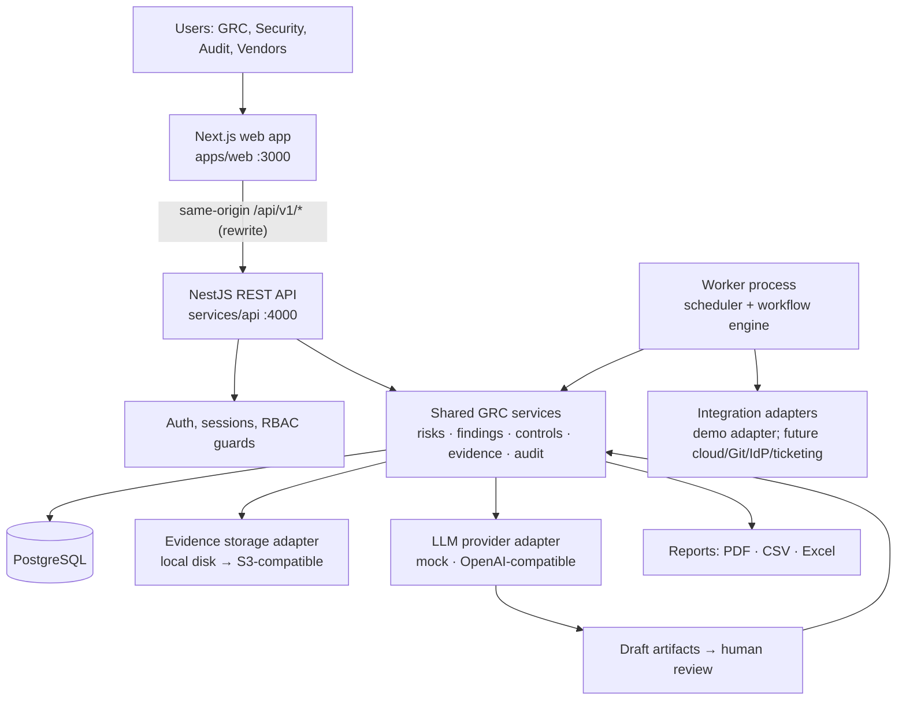

# Architecture

SentinelGRC AI is a **modular monolith**: one web application, one API, one background worker and one PostgreSQL database (spec §0.1 rule 10). The worker runs the same code as the API but in a separate process, so scheduled jobs never execute inside HTTP requests (spec §3.2).

## Components



| Component | Path | Responsibility |
|---|---|---|
| Web | `apps/web` | Next.js 16 App Router UI. Calls the API only through same-origin `/api/v1/*` (rewritten to the API), so session cookies stay first-party. Holds no secrets. |
| API | `services/api/src` | NestJS 12 HTTP API. Every route passes authentication, CSRF, tenant-context and permission guards. |
| Worker | `services/api/src/worker.ts` | Nest application context with the scheduler. Claims due jobs from the database, runs them with the organization and actor context they were created with. |
| Database | PostgreSQL 18 | Neon (hosted) for dev/demo; embedded PostgreSQL for local tests; Docker Postgres for the single-host deployment. |
| Storage | `StorageAdapter` | `local` (outside any web root) in development; `s3` for production. Server-generated keys only. |

## API module layout (`services/api/src`)

```
main.ts / worker.ts        entry points
config/                    zod-validated environment (fails fast in production)
common/                    errors, pagination, request context (AsyncLocalStorage), guards, decorators
prisma/                    PrismaService (driver adapter), transaction helper
modules/
  auth/ users/ organizations/        identity, sessions, memberships, invitations
  audit/                              audit events (append-only API)
  frameworks/ controls/ evidence/     compliance core
  risks/ findings/ remediation/       shared risk engine
  vendors/ assessments/               third-party risk
  ai-governance/                      AI systems, assessments, evaluations, incidents, changes
  workflows/ notifications/ integrations/
  assistant/                          LLM adapter + draft artifacts
  reports/ dashboard/ search/ health/
```

Each module has a controller (HTTP only), a service (business rules, transactions, audit) and uses Prisma through the service. Modules call each other's **services**, never each other's tables directly, which keeps the shared entities (risks, findings, evidence) owned by one module.

## Request lifecycle

1. `RequestIdMiddleware` assigns/propagates `X-Request-Id`.
2. `SessionGuard` resolves the `sg_session` cookie → session row (by SHA-256 hash) → user and **active organization membership**. Missing/expired → 401.
3. `CsrfGuard` (mutating methods) checks the `X-CSRF-Token` header against the `sg_csrf` cookie and checks `Origin`.
4. `PermissionGuard` checks `@RequirePermission('risk.update')` against the membership's effective permissions. Deny by default: a route without a permission decorator and without `@Public()` is rejected.
5. The controller passes the validated DTO to the service. The service takes `organizationId` **only from the request context**, never from the body.
6. Errors are mapped by a global filter to `{ error: { code, message, details? }, requestId }`; no stack traces outside development.

## Trust boundaries

| Boundary | Controls |
|---|---|
| Browser → web/API | HttpOnly SameSite cookies, CSRF token, CORS allowlist, security headers, rate limits |
| API → database | Least-privilege DB user, parameterized queries via Prisma, tenant filter in every query |
| API → storage | Server-generated keys, checksum, size/type limits, short-lived signed download tokens |
| API → LLM provider | Off unless `AI_ENABLED` and `AI_DATA_SHARING_APPROVED`; redaction; untrusted-content framing; output schema validation; drafts only |
| Worker → integrations | Secret references, timeouts, bounded retries, SSRF allowlist, normalized errors |

## Key decisions
See [DECISIONS.md](DECISIONS.md). Notably: NestJS instead of FastAPI (D-001), Neon + embedded Postgres (D-003), OpenAI-compatible LLM adapter with mock default (D-004).
