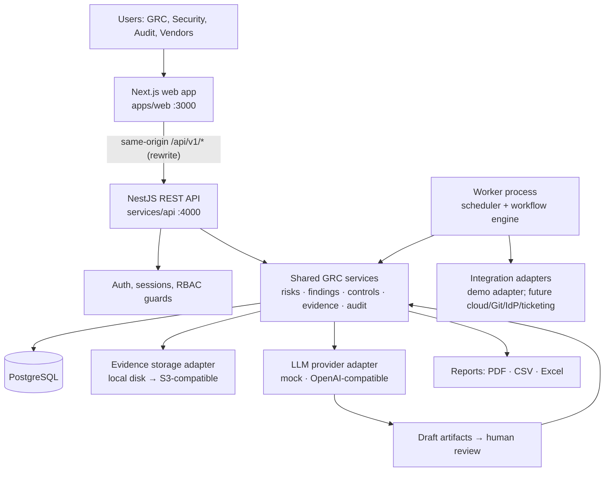

# Architecture

SentinelGRC AI is a **modular monolith**: one web application, one API, one background worker and one PostgreSQL database (spec §0.1 rule 10). The worker runs the same code as the API but in a separate process, so scheduled jobs never execute inside HTTP requests (spec §3.2).

## Components



| Component | Path | Responsibility |
|---|---|---|
| Web | `apps/web` | Next.js 16 App Router UI. Calls the API only through same-origin `/api/v1/*` (rewritten to the API), so session cookies stay first-party. Holds no secrets. |
| API | `services/api/src` | NestJS 12 HTTP API. Every route passes authentication, CSRF, tenant-context and permission guards. |
| Worker | `services/api/src/worker.ts` | Nest application context with the scheduler. Claims due jobs from the database and runs them with the organization and actor context they were created with. |
| Release | `services/api/Dockerfile` (`release` target) | Applies migrations and syncs platform reference data once per deploy, before new API and worker containers start. |
| Database | PostgreSQL 18 | Embedded PostgreSQL for local development and tests; the `postgres:18.4` image in Compose; managed PostgreSQL recommended in production. |
| Storage | `StorageAdapter` | `local` (outside any web root) in development; `s3` for production. Server-generated keys only. |

## API module layout (`services/api/src`)

```
main.ts / worker.ts        entry points (API server, background worker)
bootstrap-app.ts           HTTP hardening, CORS, OpenAPI (development only)
config/                    zod-validated environment (fails fast on unsafe production values)
common/                    errors, pagination, request context, security guard, idempotency, logger, CSV
permissions/               role and permission catalog
prisma/                    PrismaService (pg driver adapter), transaction helper
cli/                       create-admin, seed-demo, sync-reference, export-openapi, verify-restore,
                           revoke-sessions, reset-password
modules/
  auth/ organizations/                identity, sessions, invitations, members, onboarding
  audit/ notifications/ search/       append-only audit, in-app and email notifications, scoped search
  frameworks/ compliance/ controls/   framework import and mappings, compliance metrics, control register
  control-tests/ evidence/            automated and manual tests, evidence storage and links
  risks/ findings/ remediation/       shared risk engine
  vendors/                            vendors, questionnaires, assessments, scoring, vendor portal
  ai-governance/                      AI systems, assessments, evaluations, incidents, changes, EU AI Act
  workflows/ integrations/            job queue and runner, schedules, integration adapters
  assistant/ reports/ dashboard/      AI drafts, report builders and renderers, dashboard metrics
  shared/ health/                     cross-module entity resolver, liveness and readiness
```

Each module has a controller (HTTP only), a service (business rules, transactions, audit) and uses Prisma through the service. Modules call each other's **services**, never each other's tables directly, which keeps the shared entities (risks, findings, evidence) owned by one module.

## Request lifecycle

1. `RequestContextMiddleware` assigns or propagates `X-Request-Id` and opens an AsyncLocalStorage request context.
2. The global `SecurityGuard` runs in a fixed order:
   1. **Rate limit**, per IP and then per user, in `login`, `expensive` or default buckets.
   2. **Session:** the `sg_session` cookie is looked up by its SHA-256 hash, giving the user and their active organization membership. A missing or expired session gets 401, and the cookies are cleared.
   3. **CSRF and origin**, for mutating methods: `X-CSRF-Token` must match the session, and `Origin` must be allowlisted.
   4. **Permission**, from `@RequirePermission(...)`. Deny by default: a route must declare a permission, `@AuthenticatedOnly`, `@PlatformAdmin` or `@Public`. Denials are audited (`authz.denied`).
3. `IdempotencyInterceptor` replays stored responses for repeated `Idempotency-Key`s on `@Idempotent` routes (D-018).
4. The controller validates input with zod and calls the service. The service takes `organizationId` **only from the request context**, never from the body.
5. A global filter maps errors to `{ error: { code, message, details? }, requestId }`, with no stack traces or SQL.
6. Work started by the request (reports, syncs, scheduled tests) is queued with the organization, actor and request ID as its correlation ID, and executed by the worker under the same context.

## Deployment topology

```
Caddy (TLS) ─/api/v1/*─> api ─┬─> PostgreSQL (private)      release (migrations + reference sync, once per deploy)
          └─ /* ─────> web    └─> object storage (private)   worker (same image as api; scheduler + jobs)
                                                             backup (encrypted dumps + manifest, scheduled)
```

Images and the Compose templates are described in [DEPLOYMENT.md](DEPLOYMENT.md). The local stack is in `docker-compose.yml`. Logs are JSON lines in production (D-020).

## Trust boundaries

| Boundary | Controls |
|---|---|
| Browser → web/API | HttpOnly SameSite cookies, CSRF token, CORS allowlist, security headers, rate limits |
| API → database | Data-only app role (migrations use a separate owner role), parameterized queries via Prisma, tenant filter in every query, append-only triggers on history tables |
| API → storage | Server-generated keys, SHA-256 checksum, content-based type and size limits, short-lived HMAC download links bound to user and organization |
| API → LLM provider | Off unless `AI_ENABLED` and `AI_DATA_SHARING_APPROVED`; redaction; untrusted-content framing; output schema validation; drafts only |
| Worker → integrations | Secret references (env var names, never values), timeouts, bounded retries and page limits, normalized errors. No feature fetches user-supplied URLs; provider endpoints come only from server configuration. |

## Key decisions
See [DECISIONS.md](DECISIONS.md). Notably: NestJS instead of FastAPI (D-001), embedded Postgres for local work (D-007), a database-backed job queue (D-012), drafts-only AI (D-016), idempotency keys (D-018) and the release/runtime layout (D-019). The data model is in [data-model.md](data-model.md), the API conventions are in [API.md](API.md), and the threat analysis is in [THREAT_MODEL.md](THREAT_MODEL.md).
